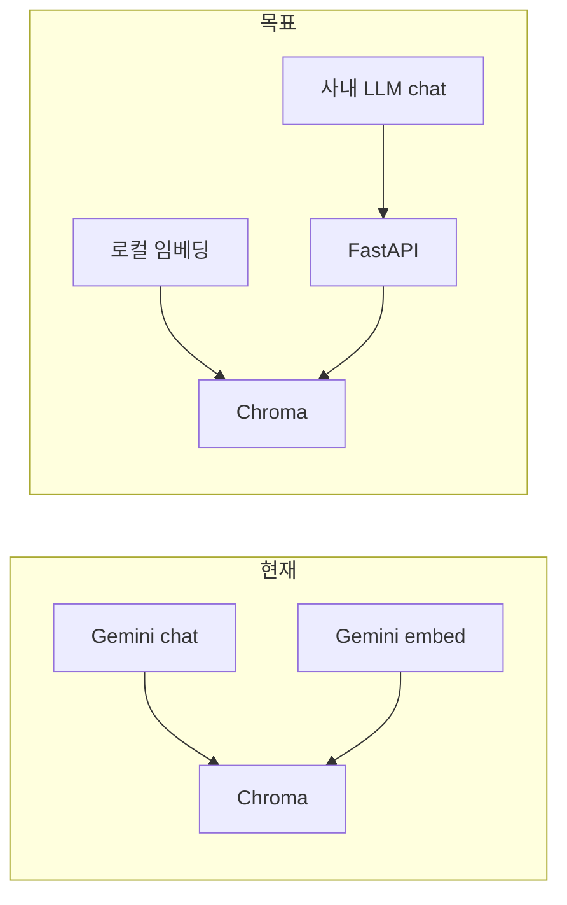

# 사내 AP 서버 이전 계획 (query-maker)

## 현재 스택과 격차

| 구분 | 현재 ([README.md](README.md), [requirements.txt](requirements.txt)) | 사내 제약 |
|------|------------------------------------------------------------------------|-----------|
| 런타임 | Python 3.11+ 백엔드 | **Python 미설치** → **오프라인 설치가 선행 과제** |
| LLM | [backend/generator/sql_generator.py](backend/generator/sql_generator.py)의 `google.genai` `generate_content` + JSON | 사내 `POST .../v1/chat/completions` (OpenAI 호환 가정) |
| 임베딩 | [backend/vectorstore/chroma_store.py](backend/vectorstore/chroma_store.py)의 `embed_content` (Gemini) | **chat만 확실** → **별도 embeddings API 없이는 기존 경로 유지 불가** |
| 프론트 | Vite dev + [frontend/src/api.js](frontend/src/api.js)의 `BASE = 'http://localhost:8000'` | 인터넷 없음 → **빌드 산출물만** 서버로 반입 |
| CORS | [backend/main.py](backend/main.py) `localhost:5173/3000`만 | 사내 브라우저 출처(호스트·포트) 추가 필요 |

핵심: **백엔드는 Python이 필수**이므로 “Python 없이 이전”은 불가능하고, **오프라인으로 Python 3.11+를 AP 서버에 올리는 것**이 인프라 작업의 첫 단계입니다.

## 1. 인프라: Python·의존성 (인터넷 있는 빌드 PC → AP 서버)

- **Python 3.11+ (Linux x86_64)**: [python.org](https://www.python.org/downloads/) **Gzipped source** 또는 **embeddable** 패키지를 USB/내부 파일서버로 옮겨 컴파일·설치(또는 사내 표준 RPM/내부 패키지 미러가 있으면 그 경로 사용). `python3`, `pip`, `venv`까지 확보.
- **wheelhouse**: 인터넷 있는 동일 OS/GLIBC 대역의 머신에서  
  `pip download -r requirements.txt -d wheelhouse`  
  (추가로 로컬 임베딩용 패키지까지 한 번에 받을 계획이면 그 `requirements`에 합침)  
  → `wheelhouse/` 전체 + 소스 트리를 AP로 복사 후  
  `pip install --no-index --find-links=wheelhouse -r requirements.txt`
- **Node는 AP에 필수 아님**: `frontend`는 빌드 PC에서 `npm ci && npm run build` 후 **`frontend/dist`만** 반입.

## 2. 애플리케이션 변경 방향 (코드)

구현 시 touched 파일 예상: [backend/config.py](backend/config.py), [backend/generator/sql_generator.py](backend/generator/sql_generator.py), [backend/vectorstore/chroma_store.py](backend/vectorstore/chroma_store.py), [backend/main.py](backend/main.py), [.env.example](.env.example), [requirements.txt](requirements.txt), 프론트의 API 베이스 URL([frontend/src/api.js](frontend/src/api.js) 또는 Vite env).

### 2-A. SQL 생성 → 사내 OpenAI 호환 Chat

- 설정 예: `LLM_BASE_URL=http://10.10.100.72:30220/v1`, `LLM_MODEL=...`, `LLM_API_KEY=`(게이트웨이가 키 없이 받으면 빈 값).
- `httpx`(또는 `requests`)로 `POST .../chat/completions`, `messages`에 system+user, **JSON만 출력**하도록 system/user에 기존 프롬프트([backend/generator/prompts.py](backend/generator/prompts.py)) 재사용.
- 응답은 `choices[0].message.content`에서 기존 `_parse_json_from_text`로 파싱. `response_format: json_object` 지원 여부는 사내 게이트웨이에 따라 선택(미지원이면 프롬프트만으로 강제).
- 토큰 사용량 필드가 없으면 `GenerationResult`의 input/output 토큰은 0 또는 생략 가능 수준으로 처리.

### 2-B. 임베딩 → 로컬 모델 (사내 embeddings 없음)

- **한 모델로 인덱싱·질의 임베딩을 모두** 수행해야 Chroma cosine 검색이 의미 있음.
- 가벼운 옵션: **`fastembed`** 또는 **`sentence-transformers`의 초소형 모델** 중 하나를 고정하고, 모델 가중치 디렉터리를 빌드 PC에서 내려받아 **통째로 AP에 복사**(캐시 경로 고정, 인터넷 없이 로드).
- [chroma_store.py](backend/vectorstore/chroma_store.py)의 `_embed_one_with_retry` / `_embed_texts_with_retry`를 Gemini 호출 대신 로컬 임베딩 호출로 교체; 설정에 `EMBEDDING_MODEL`은 “로컬 모델 식별자”로 재정의하거나 `LOCAL_EMBEDDING_MODEL` 등으로 분리.
- **기존 `chroma_db`(Gemini 임베딩으로 만든 인덱스)는 차원·공간이 달라 재사용 불가** → 사내 전환 후 **풀 재인덱싱** 또는 샘플 데이터로부터 CLI([scripts/index.py](scripts/index.py) 등)로 다시 구축.

### 2-C. 설정 정리

- `GOOGLE_API_KEY` 필수 제거: `Settings`에서 **프로바이더 분기**(예: `AI_PROVIDER=google` | `internal`) 또는 사내 전용만 지원하도록 단순화.
- 사내 전용만 두면 `google-genai` 의존성 제거 가능(휠 크기·설치 단순화).

### 2-D. CORS·프론트

- [backend/main.py](backend/main.py)에 실제 사용자가 여는 **프론트 URL**(예: `http://<AP호스트>:<정적포트>`) 추가.
- 프론트: 빌드 시 `BASE`를 AP의 API URL로 치환(Vite `VITE_API_BASE` 등)하거나, 리버스 프록시로 **동일 오리진**(`/api` 프록시) 구성 시 상대 경로로 단순화.

### 2-E. 정적 파일 서빙 (선택)

- FastAPI에 `StaticFiles`로 `frontend/dist` 마운트하거나, nginx가 정적+`/api` 프록시. 1.7GB RAM이면 **단일 프로세스(uvicorn worker 1)** 권장.

## 3. 리소스 (17GB 디스크 / 1.7GB RAM)

- 디스크: Python + venv + Chroma 데이터 + 소형 임베딩 모델 + 빌드 산출물이면 17GB 내 일반적으로 충분.
- 메모리: Chroma + 로컬 임베딩이 피크를 만듦. **인덱싱은 가능하면 RAM 여유 있는 PC에서 수행 후 `chroma_db`만 복사**하면 AP 부담이 줄어듦(질의 임베딩만 AP에서 수행).

## 4. 검증 순서 (오프라인 AP)

1. `python3 -V`, `pip install --no-index ...` 성공.
2. `.env`에 사내 LLM URL·모델명·로컬 임베딩 경로·`CHROMA_PERSIST_DIR`.
3. 샘플 엑셀로 인덱스(또는 복사한 `chroma_db`) 후 `/docs`에서 `/api/query` 스모크 테스트.
4. 브라우저에서 정적 프론트 → API 연동.

## 5. 리스크·결정 필요 사항

- **사내 chat API 스펙**: OpenAI와 필드명/스트리밍/인증 방식이 다르면 클라이언트 어댑터 조정.
- **로컬 임베딩 모델 선정**: 품질 vs RAM; 1.7GB면 아주 작은 모델부터 검증.
- **GLIBC 버전**: wheelhouse를 만든 머신과 AP 서버의 **Linux 배포판·GLIBC**가 맞지 않으면 바이너리 wheel 설치 실패 → AP와 동급 컨테이너/VM에서 `pip download` 권장.
